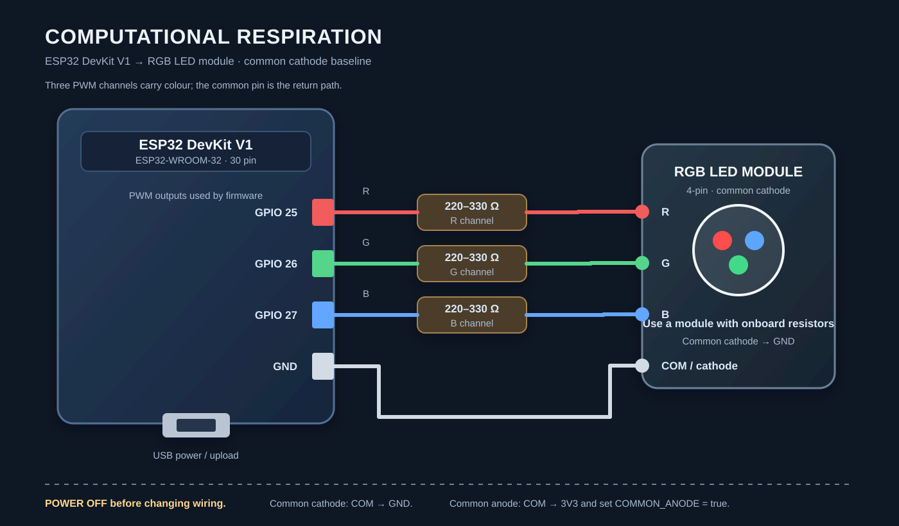

# Computational Respiration

A stable ESP32 light prototype that turns a continuous thermal-load signal into colour, brightness and breathing rhythm.

The prototype has one input, `heatValue` (0–100). A low value is a dim warm white with a slow breath; a high value is a brighter orange-red with a faster, more visible breath. The firmware smooths both the load and the breathing phase, so a new value never causes a visible jump.

## Hardware baseline

This repository targets the following purchase configuration:

- ESP32 DevKit V1 / ESP32-WROOM-32
- 4-pin RGB LED module with an onboard resistor network, **common cathode**
- USB cable and breadboard jumper wires
- If using a bare RGB LED, add one resistor (220–330 Ω) in series with each R/G/B channel.

Suggested wiring for the baseline module:


或者：


For a common-anode module, set `COMMON_ANODE` to `true` in `firmware/ComputationalRespiration.ino` and connect the common pin to 3V3. Do not connect an unknown module until its pinout and resistor arrangement are confirmed.

The full purchase and bench checklist is in [docs/hardware-checklist.md](docs/hardware-checklist.md).

## Upload and run

1. Install Arduino IDE and the Espressif **esp32** board package.
2. Select **ESP32 Dev Module** and the correct serial port.
3. Open `firmware/ComputationalRespiration.ino` and upload it.
4. Open Serial Monitor at **115200 baud**, line ending **Newline**.
5. Send `20`, `55`, or `90` to sample the low, medium and high states. Send `demo` to run the repeatable low → high → low demonstration. Send `stop` to return to manual input.

The serial output prints the target load and smoothed load. The demo lasts 30 seconds and includes a continuous rising and falling ramp.

## What makes transitions stable

- `currentHeat` follows `targetHeat` with frame-rate-independent exponential smoothing.
- The breathing phase is accumulated with elapsed time instead of being recomputed from a changing period, so changing the load does not reset the wave.
- Serial input is parsed without blocking the light update loop.
- A small gamma correction keeps low brightness visible on camera while retaining the intended mapping.

## Verification without hardware

The Python tool in [`tools/simulate_demo.py`](tools/simulate_demo.py) uses the same mapping equations as the firmware. It writes a CSV trace and renders an MP4 preview with the three labelled reference states and a continuous rise/fall sweep:

```powershell
python tools/simulate_demo.py
```

The generated files are `docs/demo-trace.csv` and `docs/continuous-load-demo.mp4`. The preview validates the software mapping only; the physical LED still needs to be tested after the hardware is purchased.

## Mapping

| Signal | Low (20) | Medium (55) | High (90) |
| --- | ---: | ---: | ---: |
| Colour | warm white | warm orange | orange-red |
| Base brightness | 38% | 61% | 84% |
| Breathing period | 5.1 s | 3.5 s | 2.0 s |

The firmware accepts every value between 0 and 100, so the three states are reference points in one continuous response.

## Demo Test


## 第一步：连接4根线

先不要给 ESP32 通电。

| ESP32 DevKit V1 | KY-016 RGB LED模块 | 线的颜色（建议） |
| --------------- | ---------------- | -------- |
| GPIO 25         | R（RED）           | &#x20;红色 |
| GPIO 26         | G（GREEN）         | &#x20;绿色 |
| GPIO 27         | B（BLUE）          | &#x20;蓝色 |
| GND             | GND（−）           | &#x20;黑色 |

接线关系

逻辑示意图：引脚位置不代表开发板的实际物理位置。

你可以采用两种接线方式：

- 直接连接： 如果ESP32和LED模块都已经焊有公排针，使用4根母对母杜邦线。
- 面包板连接： 将模块插入面包板上不同的电气连接排，再用杜邦线连接ESP32。

如果你的KY-016模块已经自带合适的限流电阻，就不需要再串联电阻。如果没有，每个R/G/B通道都要串联一个220–330Ω电阻。

注意：不需要把LED模块接到ESP32的5V或者3V3引脚。按照实际模块标注确认4个引脚，不要仅凭照片判断左右顺序。

## 第二步：上传GitHub程序

打开原仓库的完整程序：

[ComputationalRespiration.ino](https://github.com/610lulu/Computational-Respiration/blob/main/firmware/ComputationalRespiration.ino?utm_source=chatgpt.com)

在电脑上打开 Arduino IDE：

1. 安装 Espressif 的 ESP32 开发板软件包。
2. 使用USB数据线连接ESP32。
3. 开发板选择 `ESP32 Dev Module`。
4. 选择对应的串口。
5. 打开完整的 `.ino` 文件，点击 Upload 上传。

现有程序使用的就是 GPIO 25、26、27，因此无需修改引脚定义。

## 第三步：测试三种灯光

上传成功后，打开 Arduino IDE 的 Serial Monitor（串口监视器）。

将波特率设置为 `115200`，行结束符设置为 `Newline`。

灯光测试参考

LOWMEDIUMHIGH

LOW 低负载

串口输入

# 20

&#x20;复制

偏暖白、较暗、慢呼吸

基础亮度 约38% · 呼吸周期 约5.1秒

参考示意，实际LED颜色及明暗还受硬件影响。每次向串口单独发送一个数值。

你也可以输入 `demo`，程序会自动循环展示负载变化。


